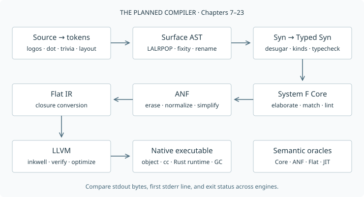

# Chapter 1: Introduction

## Motivation

I started writing this text in 2014 because the introduction I needed did not
exist. The material I found on functional compilers was often dense and hard to
approach, or written for an academic audience rather than people building
software in industry. I wanted someone to walk me through a working compiler
and explain the ideas as we needed them.

I slowly filled in the gaps in my own knowledge, but there was no reason others
should have to take the same slow route. In the spirit of “be the change you
want to see,” I decided to write the introduction I had been looking for.
This book is my way of lowering the ladder for the next person.

We will build Fun, a strict functional language with inferred types, algebraic
data, nominal records, and type classes. And building Fun is going to be fun!
The implementation is in Rust. The
finished compiler will produce native code through LLVM, alongside interpreters
that let us check what compilation preserves. The Haskell Report supplies our
baseline for syntax and typing. Differences are stated explicitly [@haskell2010].

A compiler becomes easier to understand when each transformation has a small
input language and a small output language. The early chapters study parsing,
evaluation, and inference separately. From Chapter 7 onward each crate is a
complete snapshot of the same compiler. Read a chapter together with its diff.
Run an earlier snapshot whenever you want to revisit a simpler implementation.

## Tool Setup

Use Apple Silicon macOS, or Linux on x86-64 or AArch64. We need Rust and Cargo to build the
chapters, `just` to run the repository recipes, a C compiler and Boehm GC for
the runtime, and LLVM 22 for native compilation and the JIT. The book has a
separate toolchain, installed by `just bootstrap`.

### macOS

Install Apple's command-line development tools and follow the
[Homebrew installation instructions](https://brew.sh/) if `brew` is not already
available. Then install the system dependencies:

```sh
xcode-select --install
brew install git python just llvm@22 bdw-gc pkg-config
export LLVM_SYS_221_PREFIX="$(brew --prefix llvm@22)"
export GC_LIB_DIR="$(brew --prefix bdw-gc)/lib"
```

Wait for the command-line tools installer to finish before running the build.
Keep the two exports in your shell configuration if you want them in later
terminal sessions. `llvm@22` is intentional. An unversioned LLVM package can
select a different ABI from the one used by our Rust bindings.

### Ubuntu

These commands target Ubuntu 26.04 LTS, the current LTS when this edition was
written. They also work with the supported Ubuntu 24.04 CI environment. Install
the common tools, then use the [official LLVM package installer](https://apt.llvm.org/)
to select version 22 explicitly:

```sh
sudo apt update
sudo apt install -y build-essential git curl wget ca-certificates \
  gnupg lsb-release software-properties-common python3 pkg-config \
  libgc-dev libssl-dev just
curl -fsSLo /tmp/wyah-llvm.sh https://apt.llvm.org/llvm.sh
sudo bash /tmp/wyah-llvm.sh 22
sudo apt install -y llvm-22-dev libpolly-22-dev
export LLVM_SYS_221_PREFIX=/usr/lib/llvm-22
```

The versioned LLVM prefix belongs in your shell configuration for later builds.
The distribution's default Rust package need not match the book's pinned
compiler, so install Rust through rustup next.

### Rust and the Repository

Follow the [canonical Rust installation guide](https://rust-lang.org/tools/install/).
On either platform, its rustup installer is:

```sh
curl --proto '=https' --tlsv1.2 -sSf https://sh.rustup.rs | sh
. "$HOME/.cargo/env"
git clone https://github.com/sdiehl/write-you-a-haskell.git
cd write-you-a-haskell
rustup show
rustc --version
cargo --version
```

Inside this checkout, `rust-toolchain.toml` selects Rust 1.99.0 with Clippy and
rustfmt. Rustup installs the selected toolchain when needed. The
[rustup book](https://rust-lang.github.io/rustup/overrides.html#the-toolchain-file)
explains how directory toolchains work. `just` is a command runner, not another
build system. Its [installation guide](https://just.systems/man/en/packages.html)
lists alternatives to the system packages above.

Now build a small chapter and the complete workspace:

```sh
cargo run -p ch02_calc -- repl
just build
cargo fmt --all -- --check
cargo clippy --workspace --all-targets -- -D warnings
```

For HTML and PDF, install the pinned book tools locally:

```sh
just bootstrap
just book
just pdf
```

Bootstrap installs mdBook, its preprocessors, Pandoc, and Typst under `.tools`.
The `just` recipes put `.tools/bin` on `PATH`. Fonts are already vendored in the
repository. Open `book/build/html/index.html` or
`build/write-you-a-haskell.pdf`. The published copies are the HTML at
<https://sdiehl.github.io/write-you-a-haskell/> and the PDF beside it at
<https://sdiehl.github.io/write-you-a-haskell/write-you-a-haskell.pdf>, which is also the
asset on the repository's latest GitHub release. The full compiler tests run with
`cargo test --workspace` and include long recursion and allocation regressions.

### Nix Alternative

With [Nix installed](https://nixos.org/download/), the flake supplies the pinned
Rust toolchain, LLVM 22, Boehm, a C compiler, and development tools for Apple Silicon macOS and both Linux architectures:

```sh
nix --extra-experimental-features 'nix-command flakes' develop
just build
just bootstrap
just pdf
```

The lock file fixes the package inputs. The shell sets the LLVM and GC paths,
so it replaces the platform package-installation steps above. Bootstrap still
installs the book's exact tool versions into `.tools`.

## Why Rust

When I first wrote this book in the mid-2010s, Haskell was an appealing way to
explain a compiler. Algebraic data types, pattern matching, and a compact syntax
made the transformations almost read like their mathematical definitions. But
getting from those definitions to a complete native compiler already meant
relying on libraries whose support was thin. In my experience, that maintenance
problem has grown worse with time.

I still love Haskell's surface language. I no longer consider it a good practical
choice for building the compiler in this book. A compiler needs maintained
bindings, diagnostics, testing tools, packaging, and a predictable runtime as
well as elegant tree transformations. Implicit laziness also puts extra distance
between the program I write and its allocation and evaluation behavior. Those
costs matter when a compiler must process large inputs reliably.

Rust is my choice for this edition because of its much broader ecosystem and
sustained investment in production tooling. It offers enums and pattern matching
for our intermediate languages, explicit ownership for their storage, and direct
access to LLVM and the native runtime. Cargo makes the chapter snapshots easy to
build and test together. I want readers to spend their time learning compilation,
with a toolchain they can continue using after the last chapter.

For this project, Rust is the best balance of expressive implementation code and
practical engineering. Perhaps there will be an OCaml edition one day. For now,
Haskell remains a language worth studying, while Rust is the language I want to
build in.
The original Haskell edition is preserved in the repository under the
`haskell-edition` tag.

## Why a strict Haskell-like language?

Haskell's strongest lessons survive without making every ordinary computation
potentially lazy: algebraic data, pattern matching, principal types, purity, and
type classes. Fun keeps those ideas and chooses call-by-value. Arguments are
computed before a call, constructor fields before construction, and ordinary
bindings before their bodies. This gives the reader a direct account of when
work happens and where storage is needed.

I do not see implicit laziness as a productive default for a new language. A
suspended expression may retain its environment long after its source binding
looks finished. Forcing it can move both work and failure far from their cause.
Sharing can avoid repeated work, but it introduces its own allocation and update
protocol. Strictness analysis can recover efficient execution in many cases,
yet that is substantial machinery to reconstruct a cost model we could have
made explicit from the start. Chapter 5 studies the tradeoff in executable form.

Delayed computation is still useful. My preferred foundation for making it
opt-in is **call-by-push-value** (CBPV). It separates values from computations:
a computation can produce a value, and a value can hold a suspended computation.
Explicit thunk and force operations mark the boundary. Both call-by-value and
call-by-name can be expressed through these smaller operations [@levy2001].
The programmer or compiler can therefore specify where delay belongs instead
of inheriting it everywhere.

CBPV does not by itself memoize a suspension. Call-by-need additionally requires
sharing and an update that remembers the result. Forcing an ordinary thunk twice
can run its computation twice. That distinction is precisely why I prefer this
foundation for exploring laziness. Fun itself remains a strict call-by-value
language: it implements neither CBPV nor lazy values. An explicit account of
delay is a direction for a later language, beyond this book's compiler.

## Chapter roadmap

The tables below describe the complete book. Linked titles open each chapter.
Chapters 2–6 are standalone languages. Chapters 7–24 are successive snapshots of Fun. Each row names the
piece you will build, rather than a list of prerequisites.

### Part I: Foundations

| No. | Topic                                              | What you will build                                                                             |
| --: | -------------------------------------------------- | ----------------------------------------------------------------------------------------------- |
|   1 | [Introduction](ch01-introduction.md)               | The workspace, test runner, chapter tools, and HTML/PDF book pipeline.                          |
|   2 | [Parsing](ch02-parsing.md)                         | An arithmetic language with logos, LALRPOP, a comparison Pratt parser, diagnostics, and a REPL. |
|   3 | [Lambda Calculus](ch03-lambda.md)                  | Substitution, de Bruijn indices, normal-order reduction, and strict closures.                   |
|   4 | [Simply Typed Lambda Calculus](ch04-stlc.md)       | Annotated functions and a type checker that runs before evaluation.                             |
|   5 | [Evaluation](ch05-evaluation.md)                   | Recursive functions, a constant-stack CEK machine, and a call-by-name comparison.               |
|   6 | [Hindley–Milner Inference](ch06-hindley-milner.md) | Polymorphic let inference, using both Algorithm W and level-based union-find.                   |

### Part II: Frontend

| No. | Topic                                                    | What you will build                                                                     |
| --: | -------------------------------------------------------- | --------------------------------------------------------------------------------------- |
|   7 | [Design of Fun](ch07-fun.md)                             | The first Fun compiler, with source spans, diagnostics, pass sessions, Core, and a CLI. |
|   8 | [Layout and the Extended Parser](ch08-layout.md)         | Offside layout, comment-preserving formatting, signatures, fixities, and sections.      |
|   9 | [The Renamer](ch09-renamer.md)                           | Unique names, lexical scopes, dependency components, and mutual recursion.              |
|  10 | [Typed Core and Core Lint](ch10-typed-core.md)           | System F elaboration and independent Core lint to catch compiler mistakes.              |
|  11 | [Datatypes and Pattern Matching](ch11-datatypes.md)      | Algebraic data, lists and tuples, nested patterns, equations, and guards.               |
|  12 | [Records](ch12-records.md)                               | Nominal records with construction, updates, patterns, and resolved dot projection.      |
|  13 | [Kinds and Type Constructors](ch13-kinds.md)             | Higher-kinded constructors, inferred kinds, and checked type synonyms.                  |
|  14 | [Type Classes](ch14-type-classes.md)                     | Constraints, instances, superclasses, defaults, dictionary passing, and Double.         |
|  15 | [Monads, Do Notation and IO](ch15-io.md)                 | Higher-kinded control classes, do-notation, opaque IO, and effectful programs.          |
|  16 | [Pattern-Match Compilation](ch16-pattern-compilation.md) | Decision trees and join points, with exhaustiveness and redundancy warnings.            |
|  17 | [The Prelude and Deriving](ch17-prelude.md)              | The full source Prelude and generated Eq, Ord, and Show instances.                      |

### Part III: Backend

| No. | Topic                                                  | What you will build                                                                    |
| --: | ------------------------------------------------------ | -------------------------------------------------------------------------------------- |
|  18 | [A-Normal Form and Join Points](ch18-anf.md)           | Type erasure, ANF, a small simplifier, and an iterative execution oracle.              |
|  19 | [Closure Conversion](ch19-closures.md)                 | Explicit environments, lifted functions, partial application, and a Flat IR oracle.    |
|  20 | [Data Representation and the Runtime](ch20-runtime.md) | Tagged words, heap layouts, eval/apply, shared primitives, and a Boehm-backed runtime. |
|  21 | [LLVM Code Generation](ch21-llvm.md)                   | Native object emission, linking, tail calls, and tests against the interpreters.       |
|  22 | [JIT and the REPL](ch22-jit.md)                        | LLVM execution and a persistent REPL with type, kind, and compiler-pass inspection.    |
|  23 | [Optimization](ch23-optimization.md)                   | Work preservation, reachable globals, and native numeric intermediates.                |
|  24 | [Precise GC (Optional)](ch24-garbage-collection.md)    | Live-root tracking, a shadow stack, and a stress-tested copying collector.             |
|  25 | [Future Work](ch25-future-work.md)                     | A guide to laziness, modules, richer types, optimization, and debugging extensions.    |

Appendices collect the grammar, typing rules, intermediate representations,
runtime ABI, and diagnostic index. A bibliography closes the book.

## How We Will Build It

We begin with a calculator. It is small enough that we can follow an expression
from the text we type to the answer it produces. We then build a few small
languages to explore functions, evaluation, and types separately. Each has a
complete Rust implementation you can run and change. You do not need to
understand a whole compiler before you can experiment with one part of it.

In Chapter 7, those ideas come together in Fun. From there, each chapter starts
with the previous chapter's compiler and adds one piece. Records extend the
language, type classes introduce a way to share operations across types, and
later chapters teach the compiler to produce native code. Every chapter has its
own crate, so you can keep an earlier version open beside the one you are
studying.

Read the changes as well as the finished code. Each chapter lists its new and
changed source files, with the important ones first. Comparing two snapshots
lets you see what a feature actually asks of the compiler: a new syntax node,
perhaps, followed by a typing rule and a translation. The book includes code
from those source files, so the implementation you read is the one you run.
Tests carry forward too, helping us check that adding a feature has not broken
what already worked.

The theory arrives alongside the problems it helps us solve. We will try a
small example, find the question it raises, and introduce enough notation to
make the answer precise. You can work through the code and examples first,
then return to a rule once you have seen it in action. No prior course in type
theory is assumed. Familiarity with Rust enums, pattern matching, borrowing,
and Cargo will help you follow the implementations.

## Theory

A compiler rewrites a program several times before the computer can run it.
The challenge is to change how the program is written while keeping what it
does. If your program prints `42`, the machine code we produce should also
print `42`. If it asks for your name before greeting you, compilation must keep
those actions in that order.

We will build up those steps one at a time. First we work out how the source
text fits together: in `1 + 2 * 3`, multiplication belongs inside the addition.
Then we check that the operations make sense, so adding a number to a function
is caught before the program runs. Later chapters translate the program into
simpler forms that are easier to turn into machine code.

How do we know we got a translation right? One useful trick is to write a small
interpreter for each form and run the same examples through them. If they give
different answers, we have found a compiler bug. Matching answers do not
establish that every possible program works, but they give us a practical way
to check our work as we go. Along the way, we will also learn how types and
rules about evaluation help us reason about programs beyond the examples we
can test [@pierce2002].



## Implementation

The workspace starts with `testkit` and `xtask`. Compiler snapshots will call the
same corpus API. A fixture records stdout as bytes, an optional diagnostic or
runtime-error line, and an exit code. Tests set lint on and color off. Each child
process has a timeout, with output pipes drained concurrently so large output
cannot deadlock the runner.

```rust
{{#include ../../testkit/src/lib.rs:config}}
```

`xtask new-chapter` copies a snapshot and its corpus. `check-inherit` compares each
inherited source and expectation file, checks documented changes, and runs the
chapter tests. A program inherited unchanged runs on the default engine there; the
chapter that introduces it and the final chapter run every engine. The book collector reads preprocessed Markdown in `SUMMARY.md`
order. It never substitutes raw source chapters when a build output is missing.

## Running it

Install the pinned book tools with `just bootstrap`, then run:

```text
$ cargo test --workspace
$ just book
$ just pdf
```

The HTML is in `book/build/html/`. The PDF is
`build/write-you-a-haskell.pdf`. Compiler `--dump` commands start in Chapter 2.
There is no compiler pass to dump in Chapter 1.

## Further reading

The Haskell Report is the language reference [@haskell2010]. Pierce introduces
the operational and typing judgments we will use [@pierce2002]. Kiselyov connects
type generalization with dependency tracking, preparing for Chapter 6
[@kiselyov2013].
